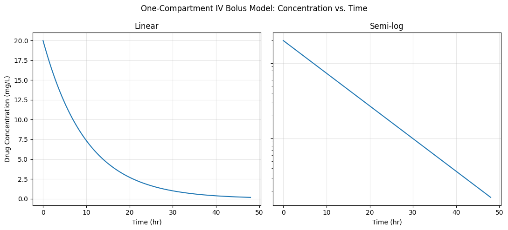
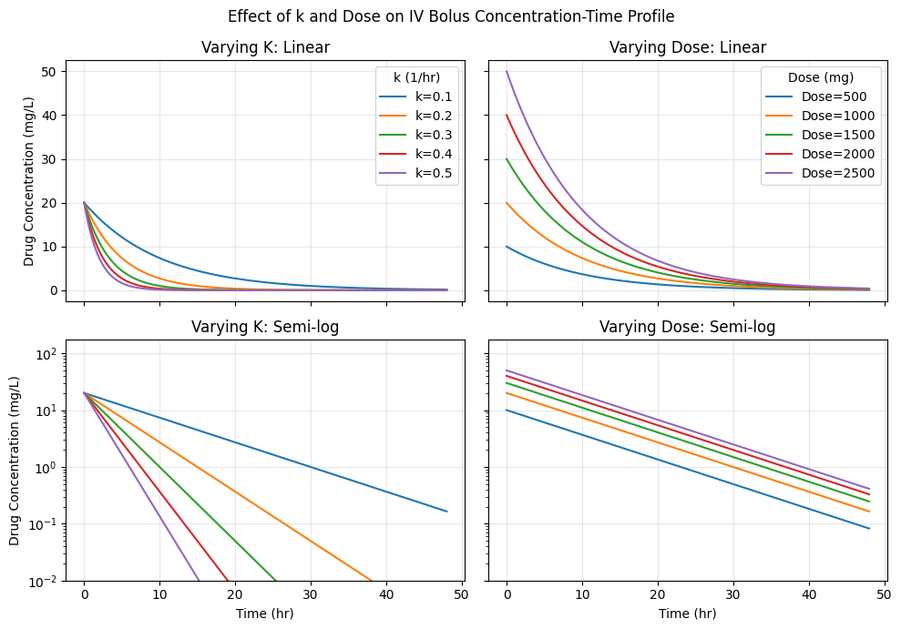
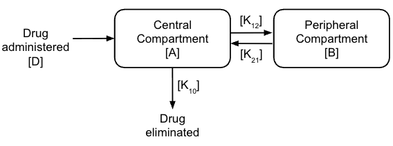
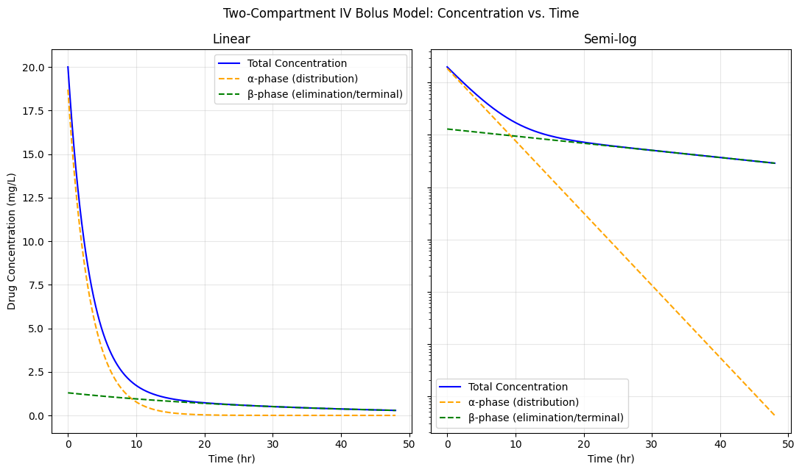
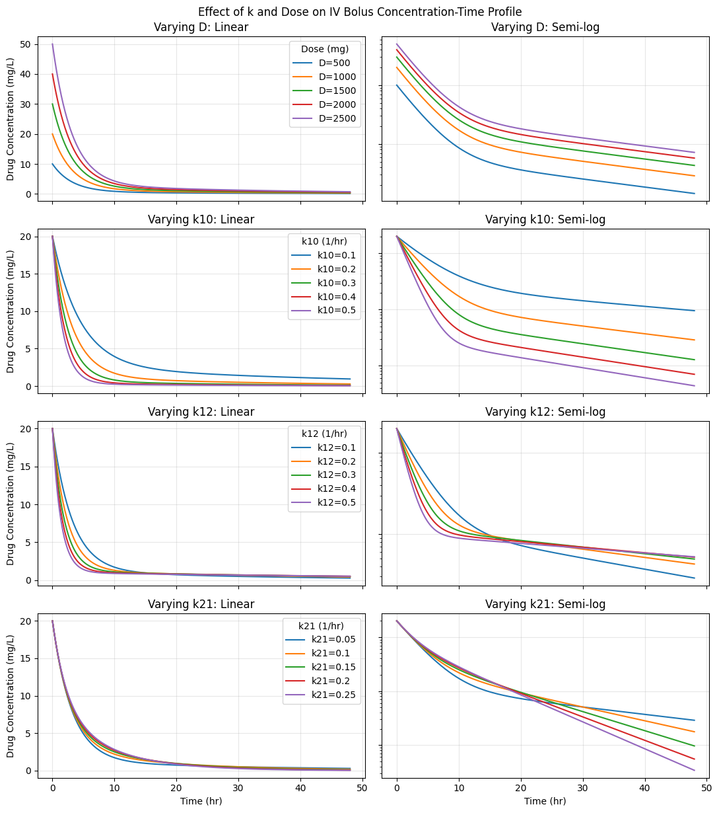
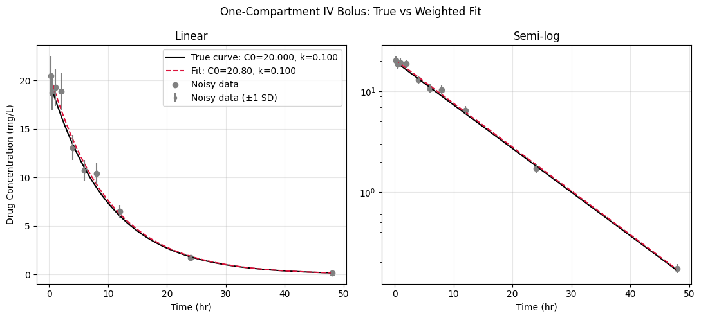
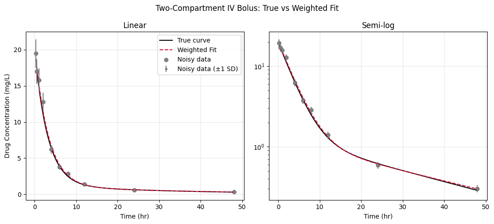

# pharmacokinetics-modelling

## Pharmacokinetic Modelling: One- and Two-Compartment IV Bolus

Deriving, simulating and fitting the two classic intravenous (IV) bolus pharmacokinetic models in Python.

In my Master of Pharmacy, the two-compartment model was given as a bi-exponential equation and fitted graphically. In this project, I derived both models from their differential equations, solved the two-compartment model as an eigenvalue problem, simulated them, and recovered their parameters from noisy simulated patient data by weighted non-linear least squares.

---

## 1. One-compartment model

**Assumptions:** the dose enters the bloodstream instantly (100% bioavailability), distributes rapidly and uniformly through a single compartment, and is eliminated by first-order kinetics, i.e. the elimination rate is proportional to the amount of drug remaining.

### Derivation

For amount of drug $A$ and elimination rate constant $k$:

$$\frac{dA}{dt} = -kA$$

Separating variables and integrating with $A(0) = D$ (the dose):

$$\int \frac{dA}{A} = -k\int dt \quad\Rightarrow\quad A(t) = D\,e^{-kt}$$

Dividing by the volume of distribution $V_d$ gives concentration:

$$C(t) = C_0\,e^{-kt}, \qquad C_0 = \frac{D}{V_d}$$

Taking logs gives a straight line, $\ln C = \ln C_0 - kt$. On a semi-log plot, **$k$ sets the slope and the dose sets the intercept**. Derived quantities: $t_{1/2} = \ln 2 / k$ and clearance $CL = k\,V_d$.

### Sensitivity analysis

Varying $k$ changes the slope of the semi-log line, while varying the dose shifts it up or down in parallel. This confirms the relationship from the derivation.

---

## 2. Two-compartment model

The drug distributes between a **central** compartment (blood and highly perfused organs) and a **peripheral** compartment (less-perfused tissues such as muscle and fat), and is eliminated from the central compartment.

### Derivation as an eigenvalue problem

With $A$ and $B$ the amounts of drug in the central and peripheral compartments (not the coefficients $A$, $B$ often used for the bi-exponential curve):
 
$$\frac{dA}{dt} = -(k_{10}+k_{12})A + k_{21}B, \qquad \frac{dB}{dt} = k_{12}A - k_{21}B$$
 
In matrix form, with $\mathbf{x} = (A, B)^\top$, $\dfrac{d\mathbf{x}}{dt} = K\mathbf{x}$ where
 
$$K = \begin{pmatrix} -(k_{10}+k_{12}) & k_{21} \\ k_{12} & -k_{21} \end{pmatrix}$$
 
The solution is a sum of exponentials whose rates are the eigenvalues of $K$. Setting $\det(K - \lambda I) = 0$ gives
 
$$\lambda^2 + (k_{10}+k_{12}+k_{21})\lambda + k_{10}k_{21} = 0$$
 
whose roots are $\lambda = -\alpha, -\beta$:
 
$$\alpha, \beta = \frac{(k_{10}+k_{12}+k_{21}) \pm \sqrt{(k_{10}+k_{12}+k_{21})^2 - 4k_{10}k_{21}}}{2}$$
 
Applying the initial conditions $A(0) = D$, $B(0) = 0$ and dividing by the central volume ($C_0 = D/V_1$) gives the bi-exponential curve used in practice:
 
$$C(t) = C_0\left[\frac{\alpha - k_{21}}{\alpha - \beta}\,e^{-\alpha t} + \frac{k_{21} - \beta}{\alpha - \beta}\,e^{-\beta t}\right]$$
 
- **$\alpha$ (fast):** the distribution phase, a steep early decline as drug moves into the peripheral compartment.
- **$\beta$ (slow):** the terminal elimination phase, with terminal half-life $\ln 2/\beta$.
 

### Sensitivity analysis

The notebook varies the dose, $k_{10}$, $k_{12}$ and $k_{21}$ in turn, showing how each affects the distribution and elimination phases.

---

## 3. Parameter estimation from noisy data

**Simulated patient data:**
- 10 samples over 48 h (0.25, 0.5, 1, 2, 4, 6, 8, 12, 24 and 48 h), mimicking a sparse clinical sampling schedule.
- 10% proportional Gaussian noise (higher concentrations are noisier), with a fixed random seed for reproducibility.

**Fitting:**
- **Weighted** non-linear least squares with `scipy.optimize.curve_fit`, minimising $\sum_i \left(\frac{C_i^{\text{obs}} - C(t_i)}{\sigma_i}\right)^2$ with $\sigma_i = 0.1\,C_i^{\text{obs}}$, so that early, high concentrations don't dominate the fit.
- **$C_0$ is fitted rather than $D$ and $V_d$ separately.** From concentrations alone, only their ratio is identifiable. With a known dose, $V_d = D / C_0$.
- Standard errors come from the covariance matrix returned by `curve_fit`.

### Results

**One-compartment** (true $C_0$ = 20 mg/L, $k$ = 0.10 h⁻¹, $V_d$ = 50 L):

| Parameter | True | Fitted | Relative SE |
|---|---|---|---|
| $C_0$ (mg/L) | 20.0 | 20.80 | 4.0% |
| $k$ (h⁻¹) | 0.100 | 0.100 | 2.2% |
| $t_{1/2}$ (h) | 6.93 | 6.91 | |
| $V_d$ (L) | 50.0 | 48.1 | |
| $CL$ (L/h) | 5.00 | 4.82 | |

**Two-compartment** (true $C_0$ = 20 mg/L, $k_{10}$ = 0.20, $k_{12}$ = 0.10, $k_{21}$ = 0.05 h⁻¹):

| Parameter | True | Fitted | Relative SE |
|---|---|---|---|
| $C_0$ (mg/L) | 20.0 | 20.48 | 5.9% |
| $k_{10}$ (h⁻¹) | 0.200 | 0.196 | 5.9% |
| $k_{12}$ (h⁻¹) | 0.100 | 0.094 | 10.7% |
| $k_{21}$ (h⁻¹) | 0.050 | 0.045 | 20.5% |
| $\alpha$ (h⁻¹) | 0.319 | 0.306 | |
| $\beta$ (h⁻¹) | 0.031 | 0.029 | |

---

## 4. Clinical interpretation

These parameters map directly onto prescribing decisions:

- **Renal impairment:** for a renally cleared drug, reduced kidney function lowers $k$ (or $k_{10}$). Halving $k$ from 0.10 to 0.05 h⁻¹ doubles the half-life from 6.9 h to 13.9 h. On repeated dosing, drug accumulation occurs unless the dose is reduced or the dosing interval extended.
- **Timing of blood samples:** in a two-compartment drug, samples taken during the distribution ($\alpha$) phase overestimate the concentration that persists in the body, so therapeutic drug monitoring samples are taken once distribution is complete.

---

## Limitations

- **Simulated data.** The model structure and noise model are known in advance, so recovering parameters is easier than with real patient data, where the model itself is uncertain.
- **IV bolus only.** There is no absorption phase (oral dosing) and no infusion.
- **Single subject.** There is no between-patient variability, which population PK models (e.g. non-linear mixed effects) would capture.
